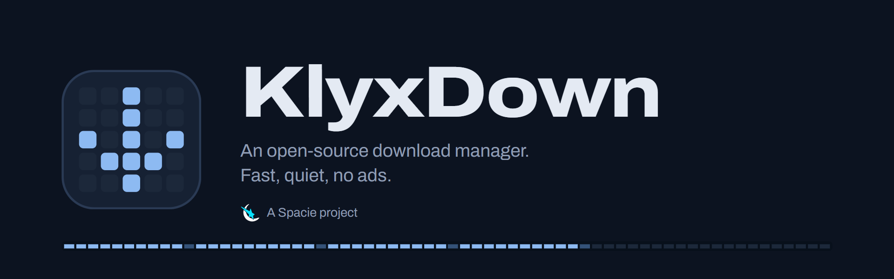
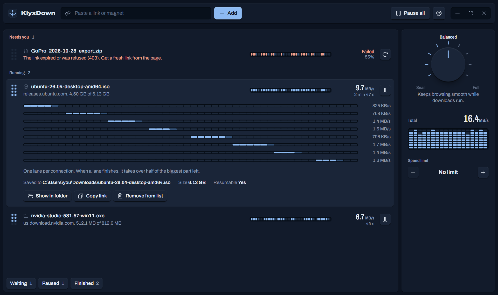
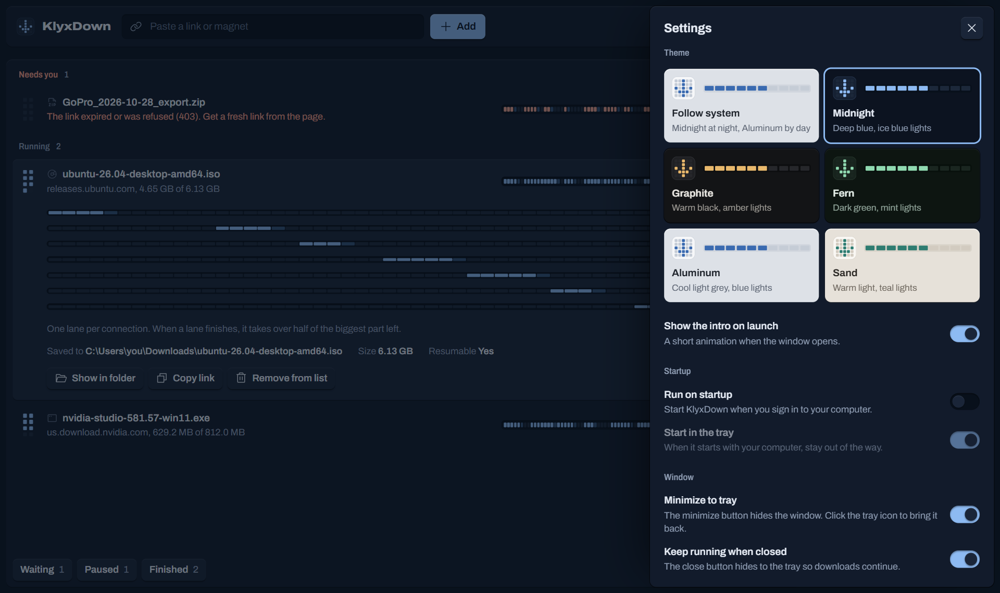
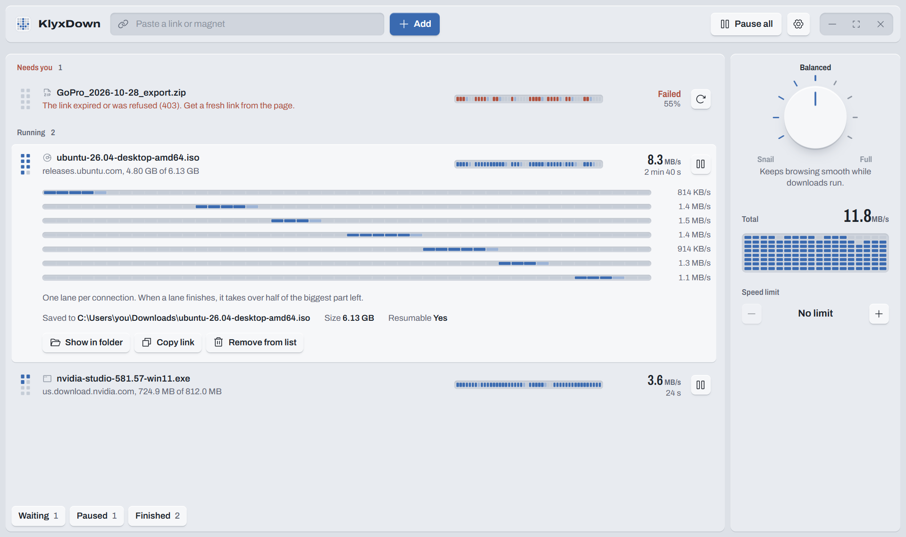
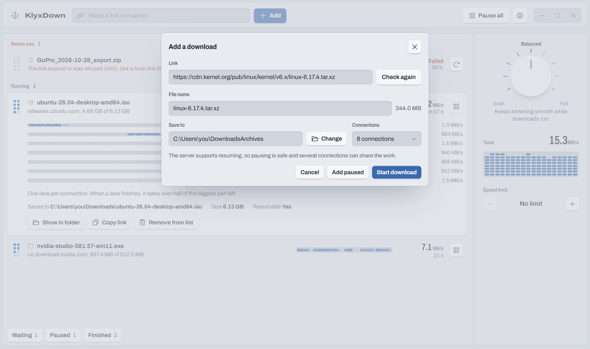
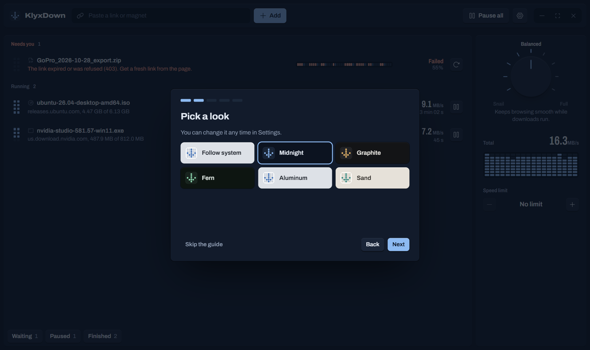

<p align="center">
  
</p>

<p align="center">
  <a href="https://spacie.net/klyxdown"></a>
  A <a href="https://spacie.net/klyxdown">Spacie</a> project.
  <a href="https://spacie.net/klyxdown">spacie.net/klyxdown</a>
  ·
  <a href="https://github.com/abdvlrqhman/KlyxDown/releases">Downloads</a>
  ·
  <a href="docs/PLAN.md">Roadmap</a>
  ·
  <a href="LICENSE">GPL-3.0</a>
</p>

KlyxDown is a free, open-source download manager for Windows, macOS and Linux. It splits every file into parts that download at the same time, picks up where it left off after crashes or lost connections, and catches downloads from your browser. No ads, no tracking.

<p align="center">
  
</p>

## What it does

- **Faster downloads.** Up to 32 connections per file. When one finishes its part, it takes over half of the biggest part still left, so no connection sits idle. Slow connections are replaced automatically.
- **Safe to stop.** Pause, quit or lose power: progress is saved and resumes later. Before resuming, KlyxDown checks with the server that the file has not changed.
- **Works with your browser.** An extension for Chrome, Edge, Brave, Opera, Vivaldi, Firefox and Safari hands downloads over with their cookies, so sites you are signed in to work too. Right-click to download a link, a selection, or every link on a page. A built-in browser covers sites the extension can't reach.
- **Video and audio.** Paste a page from YouTube, Vimeo and a thousand other sites, pick a quality, and KlyxDown fetches it with yt-dlp and joins picture and sound with ffmpeg (both installed on first use, after asking). The extension spots video on any page. Convert finished files to MP4, MP3 and more, and watch videos while they still download.
- **Torrents.** Magnet links and `.torrent` files, pick the files you want, watch while downloading, and keep sharing afterwards up to a goal you set.
- **More ways in.** FTP and FTPS, several mirrors for one file, Metalink, batch links like `photo[001-120].jpg`, one file out of a remote ZIP, a site grabber (every image on a site, say) and a folder explorer for web listings and FTP servers. Expired links get a fresh one without losing progress.
- **Organized.** Queues with their own number of downloads and weekly hours (a night queue), search, an hourly quota, a hold on metered connections, folders by type, MD5/SHA-1/SHA-256/SHA-512 checks, and link lists (including IDM `.ef2` exports) can be imported.
- **Calm by design.** A quiet hardware look with six themes, a speed knob (Snail, Balanced, Full), an optional speed limit, and a tray icon that keeps it out of the way. Thirteen languages, including Arabic and Persian laid out right to left.
- **Private and safe.** No telemetry ([privacy](docs/PRIVACY.md)). Finished files get the "downloaded from the internet" mark (Windows) or quarantine flag (macOS) and can be checked by your antivirus. Site passwords live in the system keychain. The browser link uses a local pipe, never a network port; the phone remote is off unless you turn it on.

<table>
  <tr>
    <td width="50%"></td>
    <td width="50%"></td>
  </tr>
  <tr>
    <td align="center">Six themes, Midnight by default</td>
    <td align="center">Aluminum, one of the light themes</td>
  </tr>
  <tr>
    <td width="50%"></td>
    <td width="50%"></td>
  </tr>
  <tr>
    <td align="center">Add a link: KlyxDown checks it first</td>
    <td align="center">A short guide on first launch</td>
  </tr>
</table>

## Install

Download the installer for your system from [Releases](https://github.com/abdvlrqhman/KlyxDown/releases). Builds are produced by GitHub Actions for every tagged version, and installed copies update themselves from GitHub Releases (signature-checked).

**Portable mode:** put an empty file named `portable` next to `klyxdown.exe` and KlyxDown keeps its settings and download list in a `data` folder beside it.

The project is in early development. See [docs/PLAN.md](docs/PLAN.md) for what is done and what is next.

## Browser extension

The app registers its browser helper on every start, so keep it running.

- **Chrome, Edge, Brave:** open `chrome://extensions`, turn on Developer mode, choose **Load unpacked** and pick the `extension` folder. The id must read `aohhcdaipkgppefknfnindgdacepogeb`.
- **Firefox:** run `npm run extension:firefox`, open `about:debugging`, choose **Load Temporary Add-on**, pick `target/extension-firefox/manifest.json`, then allow it on all sites.

Hold <kbd>Alt</kbd> while clicking a link to let the browser download it instead.

## Build from source

Requirements: Rust 1.89+, Node 20+, and the [Tauri prerequisites](https://tauri.app/start/prerequisites/) for your system (WebView2 and the MSVC build tools on Windows).

```sh
npm install
npm run tauri dev     # run the app
npm run tauri build   # make an installer
```

`npm run dev` alone opens the UI in a normal browser with sample downloads, which is handy for styling.

Checks that CI runs:

```sh
cargo fmt --all --check
cargo clippy --workspace --all-targets -- -D warnings
cargo test --workspace
npm run check
npm run i18n            # every language file matches the interface's texts
npm run e2e             # the real app through WebDriver (Linux: needs tauri-driver, webkit2gtk-driver, a display)
npm run e2e:extension   # the extension in Chromium with a stand-in native host
```

Releasing, signing and the extension stores: [docs/RELEASING.md](docs/RELEASING.md).

## Layout

| Path | What |
|---|---|
| `crates/engine` | Download engine: probing, segmented HTTP downloads, queue, speed modes, SQLite persistence. Pure Rust, no Tauri. |
| `crates/bridge` | Tiny native messaging helper the browser starts; relays to the app over a named pipe. |
| `src-tauri` | Desktop shell: window, tray, settings, run on startup, browser link, commands the UI calls. |
| `src` | Svelte 5 UI. |
| `extension` | Browser extension (Chrome build; `npm run extension:firefox` makes the Firefox one). |
| `docs` | Roadmap and README images. |

## License

KlyxDown is free software under the [GNU General Public License v3.0 or later](LICENSE). You can use, study, change and share it; anything you distribute that is based on it must stay open under the same license.

**Commercial licensing.** Companies that want to use KlyxDown under other terms, for example inside a closed-source product or with support, can get a commercial license from Spacie: [support@spacie.net](mailto:support@spacie.net).

Contributions are welcome; see [CONTRIBUTING.md](CONTRIBUTING.md).
